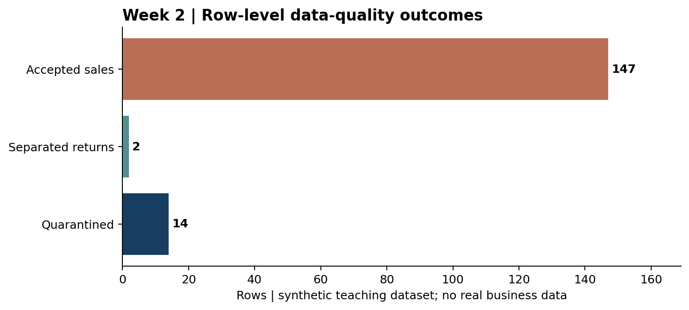

# Fashion Data Acquisition & Preprocessing Techniques
**Week 2 | Junior Data Science Analyst Internship | Revised 22 October 2026**

**Evidence uses 163 synthetic teaching transactions; public datasets listed separately were not run in the offline case study.**

## Executive summary

This report documents a reproducible data acquisition and preprocessing procedure for fashion and apparel analytics. The focus is not just obtaining files: it is constructing a trustworthy, auditable dataset whose quantities, returns, customer identifiers, apparel sizes and prices have clear definitions. A deterministic synthetic clothing-order example is executed end to end so an evaluator can inspect real code output, a source checksum, quarantined rows, derived features and automated tests. External public sources are independently catalogued for future research; they are not passed off as datasets that were downloaded or analyzed in this offline demonstration.

The example starts with 163 deliberately imperfect rows and finishes with 147 clean sales lines, 2 valid return lines, and 14 quarantined records. The identity 163 = 147 + 2 + 14 is verified in code. Retention is 91.41%; all 11 unit tests pass. Because all order values are fabricated for teaching, none are asserted to describe a real retailer, consumer or India-wide fashion market.

## 1. Assignment objectives and deliverables

- Identify authoritative external sources and document access restrictions, licensing, update frequency and fit for each analytic question.
- Define a consistent raw-to-clean workflow with data contracts, field types, provenance, duplicate policy, quarantine and quality assessment.
- Demonstrate missing-value handling, normalization, categorical harmonization, date and money conversion, return routing and leakage-safe feature engineering.
- Provide runnable Python scripts, auditable CSV/JSON outputs, a data dictionary and regression tests suitable for another junior analyst to reproduce.
- Reflect on bias, source limitations, privacy, small sample limitations and controls required before applying the method to actual retailer data.

## 2. Source acquisition plan — fashion-oriented and general sources

Source selection begins with a business question and the level of observation needed. Product sales forecasting requires transaction or SKU-week data; trend sensing needs relative search interest; textile market context is a macroeconomic question; supplier mapping needs facility registers. These cannot be merged as if they describe the same event. For every candidate source, log the URL, owner, license, access condition, geographic/time coverage, refresh rate and whether a test download actually occurred.

| Source / official website | What it can answer | Access and limitations |
|---|---|---|
| H&M Personalized Fashion Recommendations — Kaggle / https://www.kaggle.com/competitions/h-and-m-personalized-fashion-recommendations/data | Fashion-specific article metadata, customer records and transaction histories; recommendation and category behavior | Kaggle login and acceptance of competition rules required. Large files; do not republish or claim downloaded. |
| UCI Online Retail (dataset 352) / https://archive.ics.uci.edu/dataset/352/online+retail | Orders, cancellations, customer/product IDs; validation of transaction cleaning and RFM patterns | 541,909 rows; CC BY 4.0. UK online retailer mainly sells gifts, NOT fashion. UnitPrice is GBP; document source attribution. |
| Google Trends / https://trends.google.com/trends/ | Relative search interest in cotton kurta, denim jacket, festive wear by region/date | CSV manual export. Relative normalized 0–100 search index, NOT order volume or market share; record time/geography. |
| Open-Meteo historical weather / https://open-meteo.com/en/docs/historical-weather-api | Temperature, rainfall and seasonal contextual features for apparel demand | Coordinate/date API with timezone handling; weather is contextual, not proof of causal influence. Check provider terms. |
| OGD India textile production / https://sikkim.data.gov.in/catalog/production-textile-products-india | Historical production of textile products, silk, yarn and cloth | Published historical government series; update coverage and units must be checked before use. |
| World Bank — textiles and clothing value added / https://data.worldbank.org/indicator/NV.MNF.TXTL.ZS.UN | Macro share of textiles and clothing within manufacturing value added | Country-year series; no SKU-level sales. CC BY-4.0 attribution indicated by official data page. |
| Open Supply Hub / https://info.opensupplyhub.org/resources/how-to-search | Apparel/textile facility search and supply-chain mapping | Account requirements; free exports subject to location-count limit and provider conditions. |

A suitable teaching plan is to use the synthetic fashion CSV as the executable baseline, independently download the UCI workbook to test general transaction parsing (without treating it as fashion), and treat Kaggle fashion data as conditional on explicitly accepting its rules. This avoids constructing fictitious download or evaluation claims. The optional fetch_worldbank.py script demonstrates an API request plus raw-response hashing, pagination guard, source URL and acquisition timestamp, but its network download was not executed as part of the offline test run.

## 3. Dataset selection, metadata and raw preservation

For the executable example, choose a row grain of ONE ORDER LINE. A single order_id may legitimately contain two products, so deduplicating on order_id would delete sales. The generated fixture includes order_id, line_id, UTC demonstration timestamp, product SKU, category, size, quantity, unit price in synthetic INR, discount, fictional customer ID, channel, colour and return flag. The 163 source rows are generated by a fixed seed (2026) and saved to data/raw/synthetic_fashion_orders.csv. There are intentionally two exact duplicate rows, one conflicting repeated line_id, invalid numeric strings, missing keys, date errors, returns and inconsistent size/category labels.

Preserve raw files exactly. The script calculates SHA-256 on raw bytes and writes it into quality_audit.json together with the input name and counting rules. Store separately: raw/, processed/, outputs/assets/, code, requirements and tests. Do not overwrite originals or silently repair factual values. Actual public downloads must additionally record the source URL, retrieval timestamp, publication/date version, license, required citation, checksum, data coverage, owner and any approval or access constraints.

| Data contract field | Expected type | Business or cleaning rule |
|---|---|---|
| order_id / line_id | string / string | Both required. line_id is unique per order line; order_id can repeat across lines. |
| order_timestamp | ISO-like datetime | Parse explicitly, standardize to declared timezone; invalid dates quarantined. |
| sku / category | string / controlled text | SKU required; map category synonyms but retain unresolved nonblank labels. |
| size / colour | categorical | Map Small / medium / MD etc. to S/M/L/XL; unknown values flagged. |
| quantity / return_flag | integer / bool | Positive for sales, negative for flagged returns; mismatches quarantined. |
| unit_price_inr / discount_pct | numeric / fraction [0,1] | Parse separators, symbol and percentages; never invent missing price or >100% discount. |
| customer_id / channel | string / controlled text | Retain missing customer as GUEST and exclude from person-level aggregates. |

### 4. Step-by-step preprocessing methodology

### 4.1 Ingest and validate

Read identifiers as strings to retain zero padding and prevent numeric conversion of StockCode/CustomerID. Validate required field names immediately and fail fast on missing columns. Preserve a source_row number equal to the CSV line position for row-level tracing. Create an initial profile with row count, completeness by column, exact duplicates, invalid types, date-range surprises and quantity/price bounds. The header is not a data record.

### 4.2 Standardize text, categories and timestamps

Trim whitespace, uppercase controlled vocabularies and compress repeated spaces. Use explicit dictionaries: “tees”→TSHIRT, “jeans”→DENIM, “web” / “mobile app”→ONLINE, “medium” / “md”→M. “xxxl” is not silently mapped to XL; it becomes UNKNOWN with a separate size_unknown flag. Synthetic demo timestamps are interpreted in UTC; an actual Coimbatore point-of-sale feed must supply its own authoritative timezone (typically Asia/Kolkata for India), and conversion should be tested across date boundaries. A malformed “31/09/2026” cannot be repaired by guessing.

### 4.3 Parse price, discount and units

Price parsing removes the synthetic rupee symbol and thousands commas (₹1,899.00 → 1899.00), then enforces strictly positive numeric price. Discounts “15”, “0.15” and “15%” all normalize to the fraction 0.15. Values below zero or above 1 are invalid. For the demonstration only, blank discount is treated as 0 because the fixture assumes absent promotion; do not use that rule on a live dataset until an explicit source contract confirms it. Quantity must be a non-zero whole number. A negative quantity paired with return_flag=true is routed to the returns table; a positive returned item or an unexplained negative quantity is quarantined.

### 4.4 Handle missing values and duplicates

| Condition | Rule | Why |
|---|---|---|
| Missing order_id, line_id, SKU, product category | Quarantine row and record reason | Cannot safely identify the event or the product. |
| Missing / invalid unit price | Quarantine; request source correction | Zero-fill would manufacture financial results and bias sales. |
| Missing customer ID | Set GUEST + customer_missing=true; exclude from customer-level features | Retain aggregate demand without inventing identities. |
| Missing / unexpected apparel size | UNKNOWN category + size_unknown flag | Preserves volume while highlighting fit/size uncertainty. |
| Exact full-row duplicate | Quarantine subsequent duplicate | Avoid double counting. |
| Reused line_id with contradictory fields | Quarantine conflicting line and review | Avoid selecting arbitrary revenue. |
| Same order_id, different line_id | Keep both | Multiline basket is expected and not duplication. |
| Out-of-window but valid timestamp | Retain and note period scope | Do not erase data merely because it crosses a target month. |

Why not drop all missing rows? Missingness may be systematic: cash shoppers may lack customer IDs, certain SKUs may have sparse sizing, and returns are not errors. The correct action depends on the field’s analytical role, not a generic “fillna(0)”. For supervised modelling, imputation statistics and encoders are fit on training data only, then applied unchanged to later periods to prevent information leakage.

### 4.5 Transform and engineer features

For every accepted positive sale, unit_count = quantity, gross_value = unit_count × unit_price and net_value = gross_value × (1 − discount_fraction). Example: 2 kurta units at ₹1,299 with a 10% discount produce ₹2,598 gross and ₹2,338.20 net. Build order_day, ISO year_week, calendar month, day_of_week and weekend indicator; aggregate by category-week. Create lag_1_week_units = units_sold of the PREVIOUS week, and rolling_2_week_mean_past from only the TWO PREVIOUS weeks. The first eligible weeks are NA by design; replacing them with the current target would leak future demand. Customer-level frequency and monetary features exclude the anonymous GUEST grouping.

Normalization depends on the downstream estimator. Unit price and units are left in interpretable business units in the cleaned extracts. For distance-based clustering, use RobustScaler or StandardScaler fit on training data only, store the scaler, and split chronologically if evaluating forecasts. Never normalize categorical IDs numerically, and do not transform Google Trends’ within-query 0–100 scores into supposed transaction counts.

## 5. Executed case study — concrete results

The following values are generated by executing python run_pipeline.py on the included deterministic synthetic fixture. They are independently checkable in data/processed/quality_audit.json, clean_sales.csv, returns.csv, quarantine.csv and weekly_features.csv. All revenue values use fictional, synthetic INR prices and are not observed company performance.

| Quality outcome | Measured value | Interpretation |
|---|---|---|
| Raw input lines | 163 | 160 generated source rows + 2 exact duplicate copies + 1 conflicting line ID. |
| Accepted sales | 147 | Positive, validated fashion order lines. |
| Accepted returns | 2 | Negative quantity with return flag, kept separately. |
| Quarantined lines | 14 | Nonconforming line IDs, dates, prices, quantities or category data. |
| Retained valid lines | 149 / 163 = 91.41% | Not the same as actual retailer data quality. |
| Exact duplicates | 2 | Subsequent identical rows isolated, not silently dropped. |
| Missing customer IDs retained | 2 | GUEST records retained in sales but omitted from customer features. |
| Unknown size on kept lines | 2 | Data kept with an explicit unknown-size indicator. |
| Reconciliation / tests | 163 = 147 + 2 + 14; 11/11 passed | Whole-row accounting and automated validation. |
| Synthetic gross / net sales | ₹292,860 / ₹268,664.55 | Illustrative after discounts; returns tracked separately, not deducted here. |

*Figure 1. Synthetic apparel order rows by outcome after preprocessing (source: executed Python demonstration).*

The quarantine file retains the original CSV source line number and one or more reason codes. This is important: the reason-count total need not equal the quarantine-row total if a row has multiple violations. In this fixture, invalid discounts: 2; invalid quantity: 2; invalid price: 2; missing SKU, invalid date, return-sign mismatch, missing category and missing order ID: 1 each; exact duplicates: 2; conflicting line_id: 1.

Small traceable examples are more informative than general claims: a price “₹1,899.00” is parsed as 1899.00; “medium” becomes size M; blank customer ID becomes GUEST without replacing an unknown person with a fake ID; “31/09/2026” is quarantined; two otherwise identical rows are quarantined after the first; the return with quantity −2 is retained in the returns table rather than counted as a regular sale.

## 6. Reproducible execution and file audit

Run from the root of the accompanying GitHub Week2 folder on a computer with Python installed. The pipeline does not require an API key, company database or network access. It regenerates the same synthetic source using a fixed seed, builds clean/returns/quarantine extracts, time-safe aggregate features, machine-readable quality report and visual summary. The unit-test suite checks reconciliation, exact/conflicting duplicates, sign consistency, discount and currency parsing, timestamps, source contract failure, no-leakage lagging, guest exclusion and deterministic generation.

| Action | Exact command / artifact |
|---|---|
| Install | python -m pip install -r requirements.txt |
| Generate & process | python run_pipeline.py |
| Validate | python -m unittest discover -s tests -v |
| Inspect row-level cleaning | data/processed/quarantine.csv and clean_sales.csv |
| Verify provenance | data/processed/quality_audit.json — input_sha256 and source policy |
| Inspect engineered features | data/processed/weekly_features.csv and customer_features.csv |
| Optional UCI acquisition | Manually download official UCI Excel; stage with python -m src.uci_adapter INPUT.xlsx OUTPUT.csv (GBP, not rupees) |
| Optional macro source | python -m src.fetch_worldbank --out data/external (network required; not part of offline validation) |

For production lineage, version the parsing policy with the code commit SHA, include package versions, source checksums and counts, capture failed validation thresholds, and preserve the data snapshot used for reporting. Keep identifiers/PII out of public repositories. To rerun on an authorized real apparel feed, first agree on a formal data dictionary, duplicate key and currency/timezone expectations; never simply rename real foreign-currency columns to INR.

## 7. Analyst acceptance checklist and proposed five-day plan

| Day | Execution step | Evidence / acceptance condition |
|---|---|---|
| Day 1 | Choose questions/sources, review terms and data contract | Registry: grain, license/access, date and currency coverage. |
| Day 2 | Acquire a sample, checksum, profile raw fields | Raw snapshot + profile; required columns validated. |
| Day 3 | Implement cleaning, normalization and quarantine | Every input reconciles to sale/return/quarantine exactly once. |
| Day 4 | Engineer time-safe features and review bias/privacy | Unknown flags, future-leakage check, product- and customer-level QA. |
| Day 5 | Run tests; document and package evidence | Reproduction commands, README, report, plots and GitHub links. |

Acceptance thresholds should be agreed with the business owner rather than invented from this toy dataset. Example *pilot gates*, not observed standards: ≥99% records accounted for across valid/returns/quarantine partitions; 100% unique order-line keys in accepted outputs; 100% accepted prices >0; all returns signed consistently; zero leaked future observations in lagged features; documented handling for each critical missing field; and an owner to review every quarantine cluster.

## 8. Challenges, risks and mitigations

| Challenge / consequence | Control and analytical reasoning |
|---|---|
| Unlicensed or login-gated scraping | Prefer official downloads/APIs; review competition rules and citation duties; do not commit restricted H&M raw data. |
| Customer identifiers and privacy | Use fictional IDs in public examples; keep real PII out of Git, minimize collection, restrict access, check lawful basis. |
| Returns/cancellations confused with sales | Separate returns/cancellation event flows; use signed quantities and audit status transitions. |
| Mixed INR/GBP or inconsistent timezones | Require currency+timezone fields. UCI GBP staging is not merged with synthetic INR metrics. |
| Over-aggressive duplicate deletion | Use stable line_id plus full row, investigate conflicting duplicates; preserve distinct basket lines. |
| Fashion sizes and labels vary by region | Keep original/source category mapping, unknown class and mapping version; preserve garment vs numeric size systems. |
| Distribution shift, promotions, festival peaks | Record sampling window, marketing activity and seasonality; compare across holdout periods and cohorts. |
| Small synthetic demonstration | Cannot infer actual Coimbatore demand or model accuracy; acquire permissioned observations for business validation. |
| Data leakage during imputation and feature engineering | Fit scalers/imputers only on training observations; lags use preceding periods. |
| Missingness not at random | Profile missingness by SKU/channel/time rather than hiding it with a global mean. |

## 9. Reflection and recommended next steps

This task demonstrates a critical data science principle: preprocessing is a series of domain decisions with measurable consequences. For apparel, size and colour matter; cancellations and return rates cannot be ignored; inventory cannot be optimized from invalid or double-counted order lines; and anonymous purchasers should not be transformed into fake customer histories. Separating valid events from quarantined ones preserves a transparent trail from raw information to trusted analysis.

The executed results provide evidence of procedure correctness, not evidence of commercial benefit. Next, an analyst could stage the openly licensed UCI transaction workbook to validate generic invoice parsing (clearly labelled general-gift retail and GBP), acquire Google Trends CSVs for explicit terms/geographies, and use permissioned fashion-specific sales or H&M under its competition rules for authentic apparel modelling. A reviewer should examine decisions around truly missing discounts, local time zones and reused line identifiers before adopting the cleaning policy outside this controlled fixture.

## 10. Source references — verified public pages

- Chen, D. (2015), Online Retail, UCI Machine Learning Repository, DOI 10.24432/C5BW33, https://archive.ics.uci.edu/dataset/352/online+retail (CC BY 4.0; gift retail, not apparel).
- H&M Group, Personalized Fashion Recommendations, Kaggle dataset and rules, https://www.kaggle.com/competitions/h-and-m-personalized-fashion-recommendations/data (login and competition agreement).
- Google Trends Help, FAQ about Trends data and normalization, https://support.google.com/trends/answer/4365533 ; export guide https://support.google.com/trends/answer/4365538.
- Open-Meteo, Historical Weather API Documentation, https://open-meteo.com/en/docs/historical-weather-api.
- India Open Government Data, Production of Textile Products in India, https://sikkim.data.gov.in/catalog/production-textile-products-india (check series timeliness).
- World Bank, Textiles and clothing (% value added in manufacturing), https://data.worldbank.org/indicator/NV.MNF.TXTL.ZS.UN ; API documentation https://datahelpdesk.worldbank.org/knowledgebase/articles/889392.
- Open Supply Hub, How to Search and Download Results, https://info.opensupplyhub.org/resources/how-to-search.

Verification context: public source descriptions consulted 22 October 2026. Specific optional datasets were not programmatically retrieved for the demonstration; only the clearly labelled synthetic teaching dataset was executed and measured.
